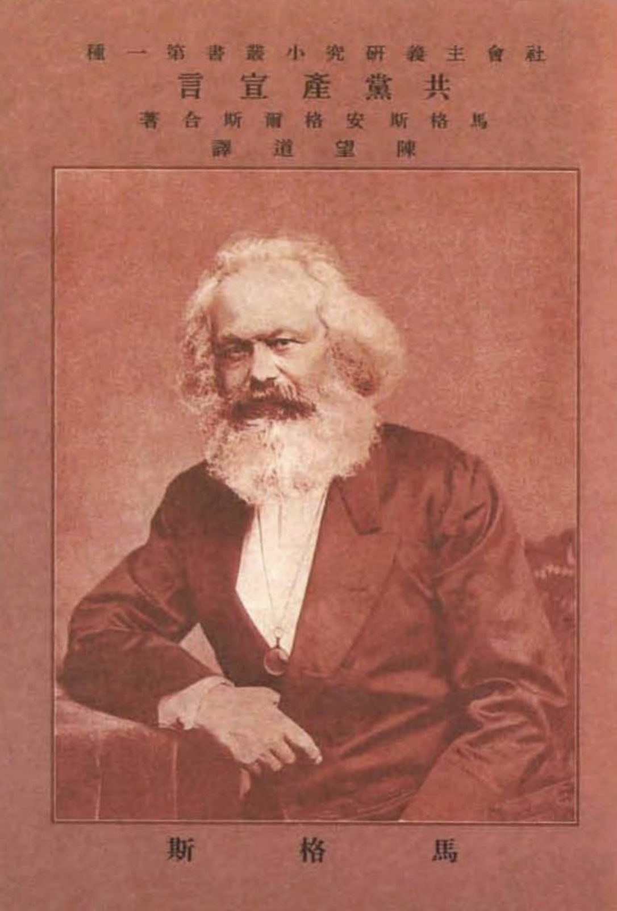
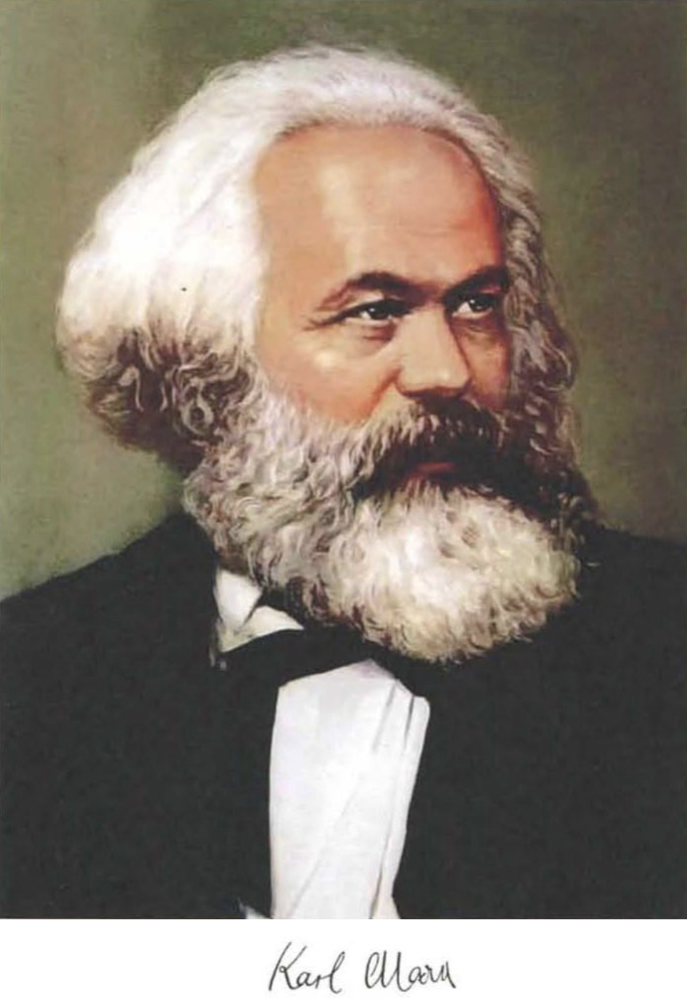
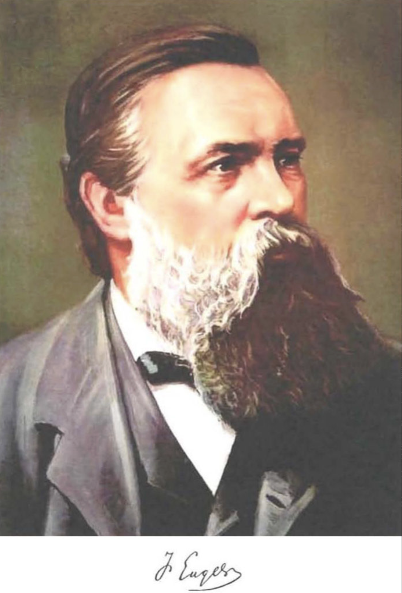
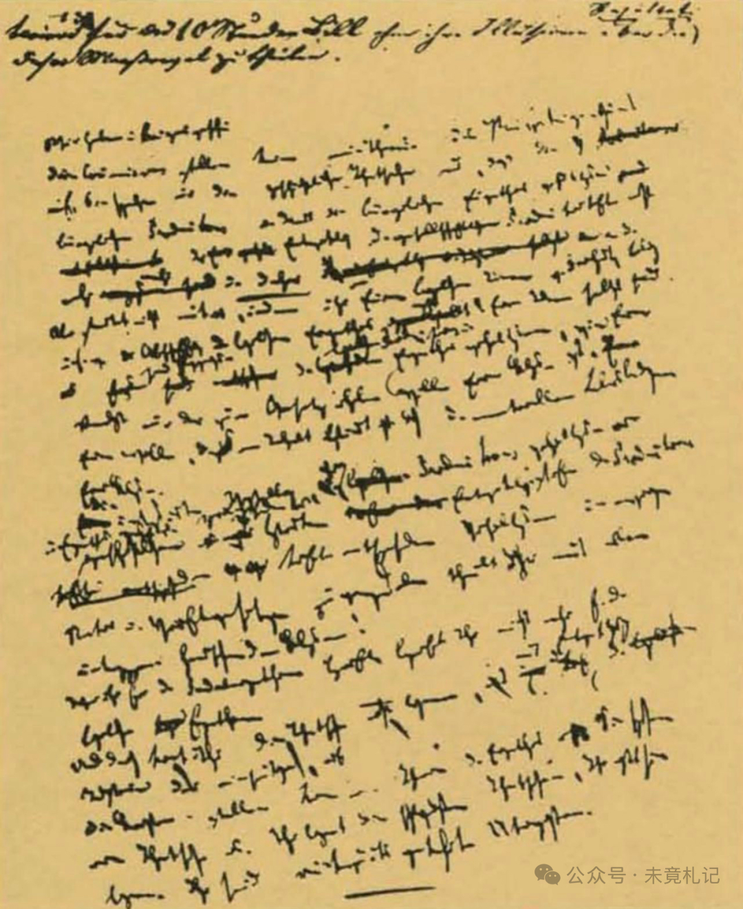
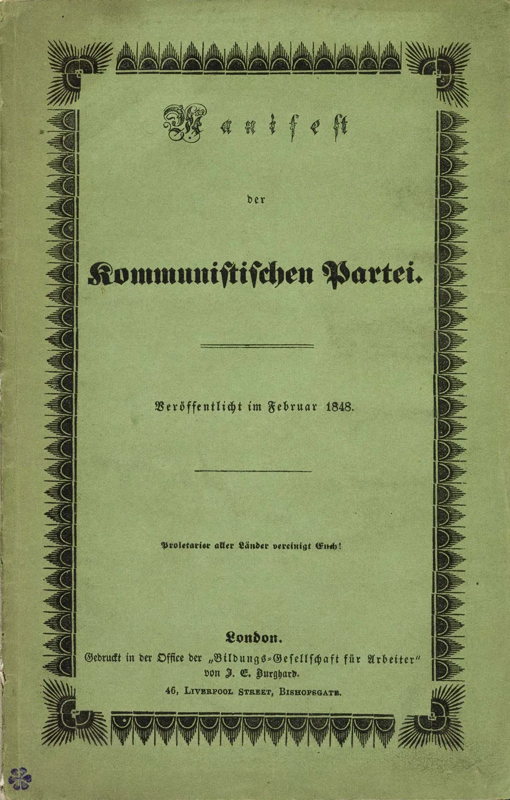
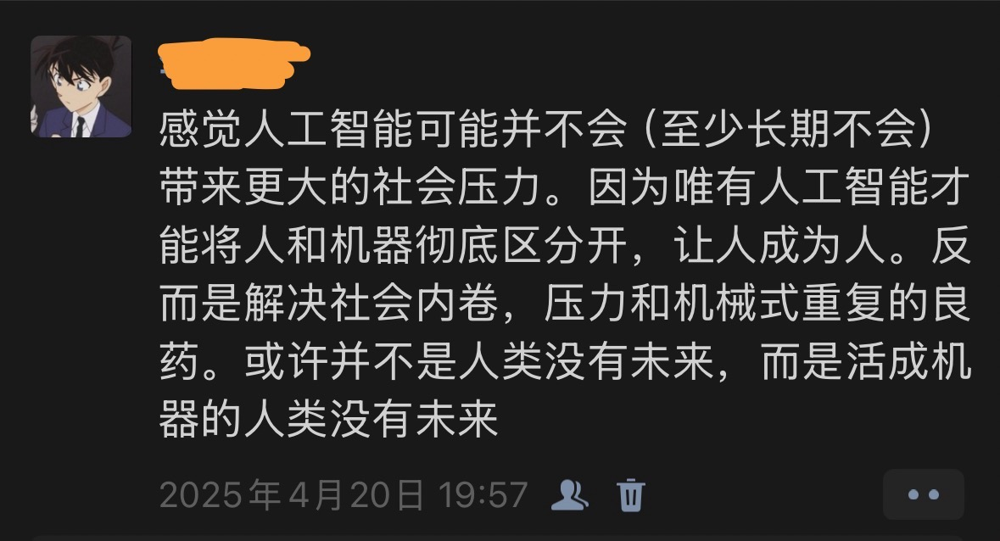

# 重新阅读《共产党宣言》：阶级、资本与人的发展

因为一句话，我重新翻开了《共产党宣言》：

> “至今一切社会的历史都是阶级斗争的历史。”

2026 年 7 月 1 日，是中国共产党成立 105 周年。借着这个时间节点，我重新阅读了《共产党宣言》。这并不是为了寻找一个可以直接照搬到今天的答案，而是为了重新理解一种观察社会、分析历史和思考制度的方式。

## 为什么今天还要读《共产党宣言》？

两年前，我曾提出过一个观点：

> 男女对立不是根本矛盾；  
> 种族对立不是根本矛盾；  
> 阶级对立才是长期存在的社会矛盾。

当时，这更多是一种直觉。今天重新阅读《共产党宣言》，我开始重新思考这个判断。

马克思为什么认为，推动人类历史发展的真正动力是阶级？他真正看见的，究竟是什么？

## 阶级对立：少数人与多数人的对立

在马克思的分析中，资产阶级与无产阶级的对立，本质上是少数人与多数人的对立。

在马克思所处的时代，资产阶级与无产阶级之间的界限相对清晰。资产、工厂、生产资料和劳动之间的关系，也更容易被观察到。

但到了现代社会，这种对立变得更加复杂。

一方面，资产阶级的存在形式变得更加隐蔽；另一方面，无产阶级内部也出现了新的分化。所谓“中产阶级”的出现，某种程度上缓和了资产阶级与无产阶级之间的直接冲突，却也进一步分化了无产阶级的力量。

这使我重新理解了《共产党宣言》中的判断：

> “至今一切社会的历史都是阶级斗争的历史。”

它并不是一句简单的政治口号，而是一种关于社会结构的分析方法。它提醒我们，许多社会冲突的背后，往往存在资源、权力、身份和生产关系的分配问题。

## 资本主义为什么永远不会停止变化？

《共产党宣言》中有一段非常重要的论述：

> “资产阶级除非对生产工具，从而对生产关系，从而对全部社会关系不断地进行革命，否则就不能生存下去……生产的不断变革，一切社会状况不停的动荡，永远的不安定和变动，这就是资产阶级时代不同于过去一切时代的地方。”

过去我理解资本主义时，更多关注它带来的积极影响：生产力发展、市场扩张、贸易自由、工业化以及生活条件的改善。

但重新阅读以后，我意识到，资本主义的另一面同样重要：它为了维持自身生存，必须不断扩张、不断革新、不断改变社会。

战争、经济危机，尤其是周期性的商业危机，并不是资本主义之外的偶然事件，而是在资本主义扩张过程中不断出现的现象。

资本主义改变的不只是财富分配，也改变了人与人的关系、社会组织方式以及人理解自身价值的方式。

## 资本改变的不只是财富，还有人与人的关系

《共产党宣言》中有一段话让我重新思考资本的力量：

> “资产阶级抹去了一切向来受人尊崇和令人敬畏的职业的神圣光环。它把医生、律师、教士、诗人和学者变成了它出钱招雇的雇佣劳动者。资产阶级撕下了罩在家庭关系上的温情脉脉的面纱，把这种关系变成了纯粹的金钱关系。”

社会主义并不只是讨论财富如何重新分配。更深层的问题是：

> 资本是否改变了人与人的关系？

在现代社会中，一个残酷但普遍存在的认知是：无产阶级，如农民、工人、手工业者，似乎天然就应该获得更低的工资、更低的生活水平，甚至被认为不应当拥有与资本家和所谓“精英”同等的社会地位。

我开始理解，为什么马克思强调人的解放，而不仅仅是财富再分配。

《共产党宣言》讨论的不只是财富问题，而是人的价值是否能够超越资本逻辑。它提醒我们：当资本成为衡量一切的标准时，人很容易被还原为劳动力、生产工具或市场中的商品。

## 为什么工资永远只是工资？

工资，或者说工人的资本，本质上是维持劳动力再生产的成本。它通常只能维持工人的生活，以及延续其后代所需的基本生活资料。

《共产党宣言》中说：

> “现代工人只有当他们找到工作的时候才能生存，而且只有当他们的劳动增殖资本的时候才能找到工作。这些不得不把自己零星出卖的工人，像其他任何货物一样，也是一种商品，所以他们同样地受到竞争的一切变化、市场的一切波动的影响。”

这段话让我意识到：工资并不是中性的收入形式。它背后是一种社会关系。

劳动者通过出卖劳动力获得生存条件，而资本通过购买劳动力实现增殖。只要这种关系存在，工人的处境就会受到市场波动、竞争压力和资本扩张逻辑的影响。

资本对于工人的剥削，并不是单一形式的。它可能来自企业主，也可能来自房东、小店主、债务关系、消费结构以及其他依附于资本逻辑的社会关系。

> “当厂主对工人的剥削告一段落，工人领到了用现钱支付的工资的时候，马上就有资产阶级中的另一部分人——房东、小店主、当铺老板等等向他们扑来。”

这也是为什么我认为，资本问题不能只从企业利润或工资水平理解。它还涉及住房、教育、消费、金融、家庭以及社会保障等更广泛的结构。

## “消灭私有制”究竟意味着什么？

第一次接触《共产党宣言》时，最容易被误解的一句话就是：

> “共产党人可以把自己的理论概括为一句话：消灭私有制。”

但重新阅读后，我意识到，这里的“私有制”并不是简单指个人生活资料。

《共产党宣言》明确指出：

> “做一个资本家，这就是说，他在生产中不仅占有一种纯粹个人的地位，而且占有一种社会的地位……因此，资本不是一种个人力量，而是一种社会力量。因此，把资本变为公共的、属于社会全体成员的财产，这并不是把个人财产变为社会财产。这里所改变的只是财产的社会性质。它将失掉它的阶级性质。”

因此，我们需要区分：

> 消灭的是资本支配劳动，  
> 而不是个人生活资料本身。

也就是说，真正的问题不是一个人能否拥有个人物品，而是生产资料和资本是否成为少数人支配多数人的工具。

## 教育：让人更像机器，还是让人成为人？

《共产党宣言》中关于教育的讨论也让我重新思考今天的 AI 教育问题。

教育本身具有明显的阶级特征。现代教育在某种程度上已经成为阶级固化的工具之一，而且这种工具性常常被我们自然地接受。

《共产党宣言》中说：

> “资产者唯恐失去的那种教育，对于绝大多数人来说，是把人训练成机器。”

当我重新读到这句话时，我想到现在的 AI 教育问题。

如果教育只是训练人完成标准化任务、给出标准化答案、适应既有生产体系，那么 AI 的出现可能会进一步强化这种趋势。人会越来越像机器，而机器反而越来越像人。

但如果教育能够重新关注问题意识、判断力、创造力、责任感和人的自由发展，那么 AI 也可能成为一种让人重新成为人的契机。

几周前，我参加了一场关于 AI Education 的国际论坛。Dr. Shabbar 提到：

> Don’t judge the answer. Judge the process.  
> Slow AI.

Dr. Azhar 也强调：

> Context matters.

两位教授都认为，AI 会改变教育评价体系。过去我担心人工智能会让人越来越像机器，但后来我开始产生一个相反的想法：

> 或许，只有人工智能才能将人和机器彻底区分开，让人重新成为人。

于是，我重新理解了马克思所说的：

> 教育不能把人训练成机器。

## 中国特色社会主义的必要性

重新阅读《共产党宣言》以后，我开始理解为什么马克思认为共产主义不能提前实现。

《共产党宣言》中有这样的判断：

> “无产阶级在普遍激动的时代、在推翻封建社会的时期直接实现自己阶级利益的最初尝试，都不可避免地遭到了失败，这是由于当时无产阶级本身还不够发展，由于无产阶级解放的物质条件还没有具备，这些条件只是资产阶级时代的产物。”

过去我总觉得，《共产党宣言》更多讨论的是一种远大的理想。现在我更清楚地意识到，马克思其实一直强调：

> 任何社会制度，都不能脱离现实生产力。

这也让我理解了中国特色社会主义的重要性和必要性。

社会主义不是抽象地跳过历史阶段，而是在具体历史条件下不断发展生产力、调整制度安排、改善人民生活，并在现实条件中逐步探索人的自由发展。

正如马克思和恩格斯在序言中所说：

> “这些原理的实际运用，正如《宣言》中所说的，随时随地都要以当时的历史条件为转移。”

这句话对今天尤其重要。

## 重新理解经典

建党 105 周年之际，我重新翻开《共产党宣言》，并不是为了寻找一个可以照搬的答案，而是为了重新理解一种观察世界的方法。

当我再次合上《共产党宣言》，我已经不再执着于证明它的每一个结论是否仍然适用于今天。真正带走的，是一种不断追问现实、理解历史、反思制度的方法。

或许，经典真正的价值，从来不是替我们回答问题，而是不断提醒我们提出新的问题。

> “在那里，每个人的自由发展，是一切人的自由发展的条件。”

## 后续问题

这次阅读没有结束问题，反而打开了更多问题：

1. 人的价值是否能够超越资本逻辑？
2. 什么才是资本主义的胜利？什么才是社会主义的胜利？
3. AI时代，生产关系是否正在发生新的变化？
4. 如何协调少数人与多数人的利益？
5. 人工智能能够让人成为真正意义上的人吗？

这些问题将继续构成我之后研究政治经济学、技术治理和社会转型的重要线索。

## References

- Marx, Karl, and Friedrich Engels. *The Communist Manifesto*.
- Marx, Karl. *Capital*, Volume I.
- Notes from previous research reflections on AI education and assessment.