> **Don't judge the answer. Judge the process.**

## Research Background

On 15 June 2026, I had the opportunity to take part in an online forum on **AI in Education**. My AI course instructor, Dr Hazlina, selected my question for discussion, allowing me to put it directly to academics from the University of Leeds. Two professors responded.

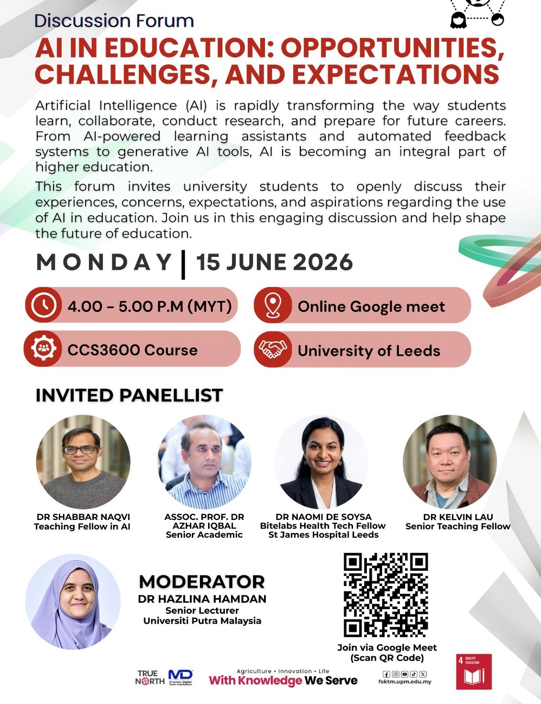

My question was:

> Recently, some universities have started experimenting with AI-first courses, where students are encouraged to use AI extensively to build products, websites, and complete projects instead of restricting AI usage.
>
> Do you think higher education should move towards an AI-native learning model, in which students are assessed on what they can create with AI rather than what they can do without it?
>
> If so, how should universities redesign teaching and assessment to ensure that students continue to develop deep understanding rather than becoming overly dependent on AI?

Although the two professors approached the issue from different research backgrounds, their answers converged on a deeper question:

**What should education evaluate in the age of AI?**

## From Evaluating Answers to Evaluating Processes

Dr Shabbar Naqvi is a Teaching Fellow in Artificial Intelligence in the School of Computer Science at the University of Leeds. He holds a PhD in Computer Science from the University of Nottingham and is a Fellow of Advance HE. His areas of expertise include artificial intelligence, explainable AI, AI in education, and assessment design.

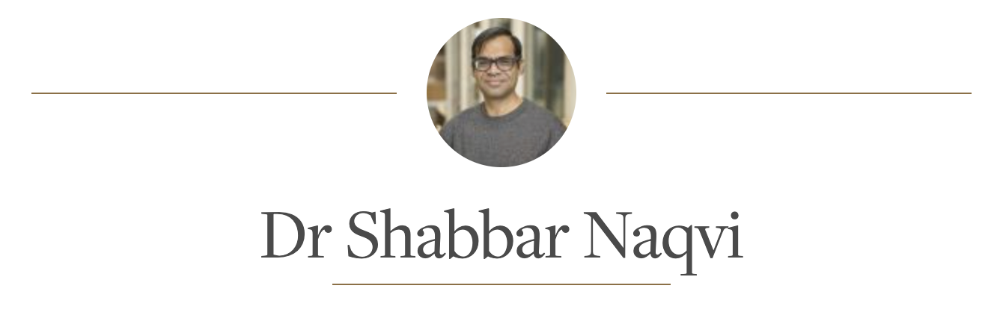

He began by arguing that AI has already become an essential tool. We cannot simply pretend that it does not exist. The more important question is:

> **How do you use AI?**

He also referred to discussions at Leeds concerning the “Green Use of AI”. The central idea is that students may use AI, but they must be able to demonstrate their own thought process.

He summarised this principle in a memorable phrase:

> **Don't judge the answer. Judge the process.**

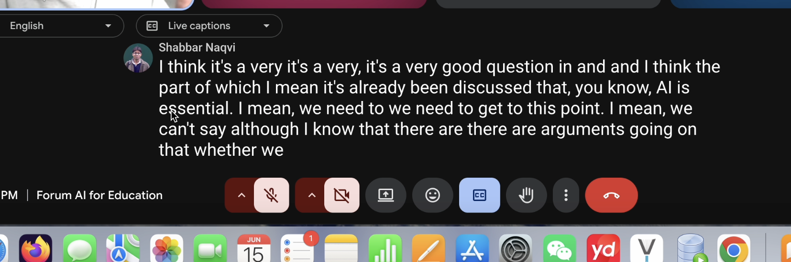


I believe the significance of this statement extends far beyond education.

In the past, systems of evaluation were largely built upon the scarcity of results. Because obtaining the correct answer was difficult, the answer itself possessed value.

In the age of generative AI, however, answers are rapidly becoming less scarce. The capabilities that remain scarce are increasingly likely to include:

- the ability to formulate meaningful questions;
- the ability to construct a reasoning process;
- the ability to assess the quality of an answer;
- the ability to choose between competing answers;
- the ability to accept responsibility for that choice.

If the industrial age trained people primarily to become executors, the age of AI may require them to become judges.

## Human Analysis and AI Assistance

Dr Shabbar further suggested that the most effective use of AI does not involve transferring the entire process of thought to a machine. Instead, human analysis should be combined with AI assistance:

```text
Human Analysis
+
AI Assistance
↓
Solution
```

This approach requires us to:

- use AI;
- retain our own analysis;
- apply our own critical thinking;
- provide AI systems with our own perspective;
- evaluate the results produced by AI.

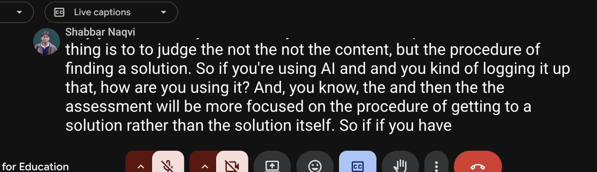

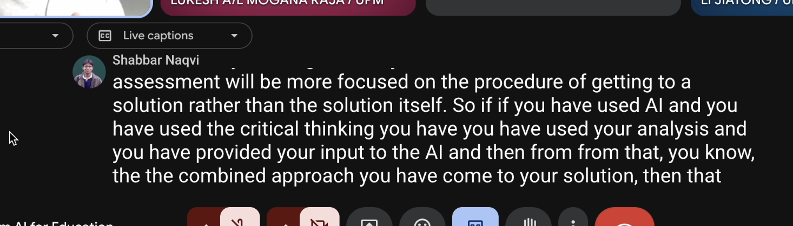

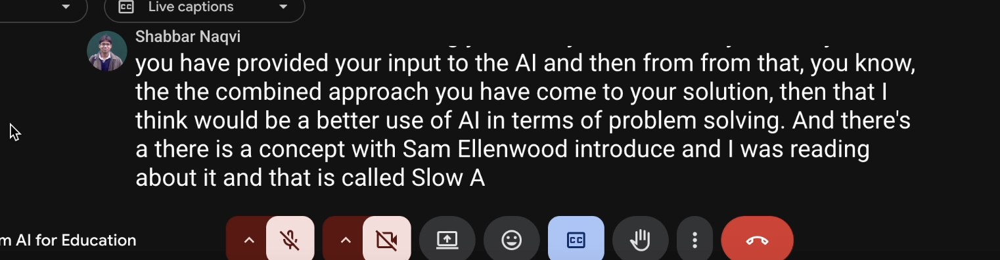

Assessment should therefore extend beyond the final answer. It should also consider how students define the problem, develop an initial position, provide the AI system with context, and verify the resulting output.

## Slow AI

Dr Shabbar concluded by introducing an interesting concept: “Slow AI”.

Slow AI does not mean rejecting AI or deliberately sacrificing efficiency. It means resisting the impulse to hand a question to AI before thinking about it independently.

A more responsible process would be:

1. Think independently.
2. Conduct your own analysis.
3. Define the problem clearly.
4. Ask AI.
5. Verify the AI-generated answer.

This differs fundamentally from the following process:

```text
Question
↓
ChatGPT
↓
Copy
↓
Submit
```

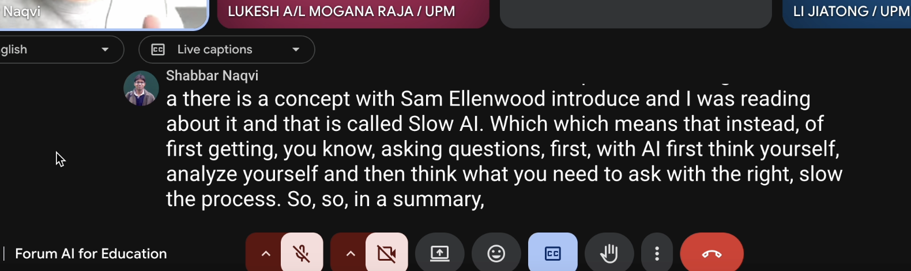

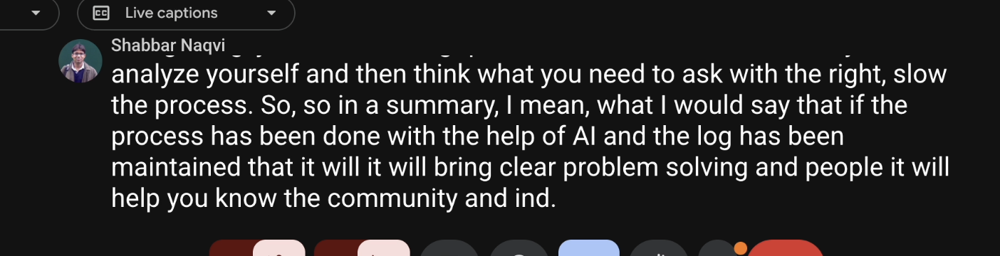

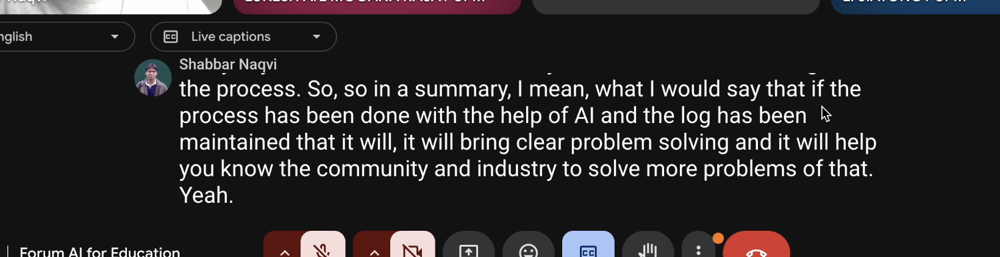

The word “slow” refers to preserving a necessary cognitive process before AI becomes involved.

AI can accelerate the production of answers, but it should not replace problem formulation, the evaluation of evidence, or the acceptance of responsibility.

## Context Determines the Standard

Dr Muhammad Azhar Iqbal is an Associate Professor of Computer Science at the University of Leeds. He completed his PhD in Communication and Information Systems at Huazhong University of Science and Technology in 2012. He has previously held academic positions at Lancaster University, Southwest Jiaotong University, and Capital University of Science and Technology in Pakistan. His research interests include cloud computing, the Internet of Things, deep learning, and digital agriculture.

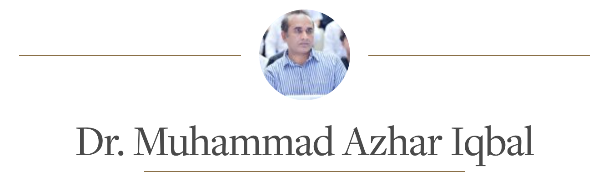

He emphasised that:

> **Context matters.**
>
> **It largely depends on the context.**

The appropriateness of AI use depends substantially on the task and the setting. Different contexts require different standards.

If students use AI to build a website or develop an application, for example, that is not necessarily a problem. Even substantial reliance on AI may be acceptable when it is consistent with the purpose of the task.


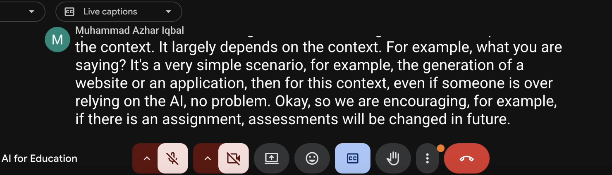

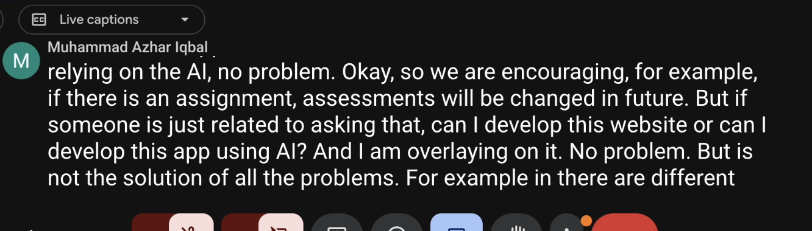

I strongly agree with this distinction because:

> **Practice is not the same as an examination.**

In a practical setting, provided that an outcome is achieved legitimately, the process of relying on AI may be evaluated. It should not, however, be judged in isolation from the purpose of the task.

Dr Azhar expressed his central point as follows:

> **It is not applicable to all things.**

In other words, no single rule governing AI use can be applied to every task and every context.

He illustrated this point through a module he teaches on intelligent systems. In some courses, asking AI directly and copying its answer is clearly unacceptable because it fails to meet the learning objectives.

As he noted:

> **Teacher feedback is still necessary.**

Teachers must still determine whether students genuinely understand the relevant material and provide appropriate feedback.

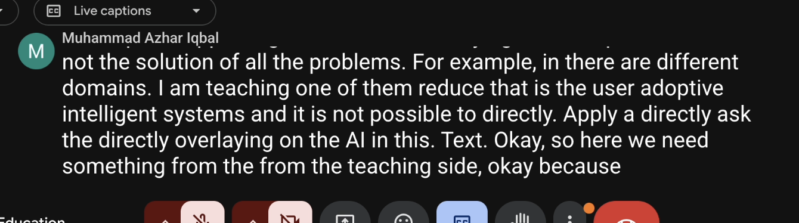


This observation is more significant than it may initially appear.

Public debate about AI frequently falls into two opposing extremes:

- supporters of AI assume that it should be used for everything;
- opponents of AI assume that it should not be used at all.

Dr Azhar's answer instead reminds us:

> **It really depends.**

The important question is not whether we support or oppose AI in the abstract. It is where, why, and how AI should be used.

## My Current Position

Although Dr Shabbar and Dr Azhar approached the question from different perspectives, both believed that:

> **Assessment will change in the future.**

In education, the shift from evaluating only final results towards evaluating the process of thought may become one of the most important transformations in assessment in the age of AI.

As AI continues to develop, it will reshape not only education but many aspects of human society.

AI literacy should become a fundamental capability for everyone preparing for the future, not only for computer science students. In many tasks, using AI rather than relying solely on individual effort may be the more appropriate choice.

We cannot avoid this development. Before AI becomes still more deeply embedded in education, work, and public life, however, revising the systems through which AI-assisted work is evaluated should be a priority.

Future assessment should not be organised around either a universal prohibition or universal permission to use AI. It should address at least three questions:

1. What capability was the task originally intended to assess?
2. After AI becomes involved, which capabilities are still demonstrated by the student?
3. Can the student explain, verify, and accept responsibility for the final result?

The object of assessment should therefore expand beyond the final answer to include problem formulation, reasoning, use of evidence, critical judgment, human-AI collaboration, and responsibility.

## Questions That Remain Open

The forum did not produce a final answer. Instead, it led me to formulate several further questions:

1. How should “thinking” be defined in the age of AI?
2. Who should determine the rules governing AI use?
3. Should different disciplines and contexts have different frameworks for AI governance?
4. Should educational institutions adapt to AI, or should they actively shape how AI is used?

These questions may ultimately be more important than any premature answer.

Perhaps this is precisely what Slow AI is intended to remind us:

> **Do not rush to obtain an answer.**
>
> **First learn to ask better questions.**

## References

- AI in Education Forum, 15 June 2026.
- Dr Shabbar Naqvi, University of Leeds.
- Dr Muhammad Azhar Iqbal, University of Leeds.

---

*Note: This article was prepared from the forum discussion, live captions, and my contemporaneous notes. Some English quotations have been lightly edited for punctuation. Where the live transcription may be inaccurate, the speakers' intended meaning should take precedence. This article records my understanding at this point in time rather than presenting a final conclusion.*
