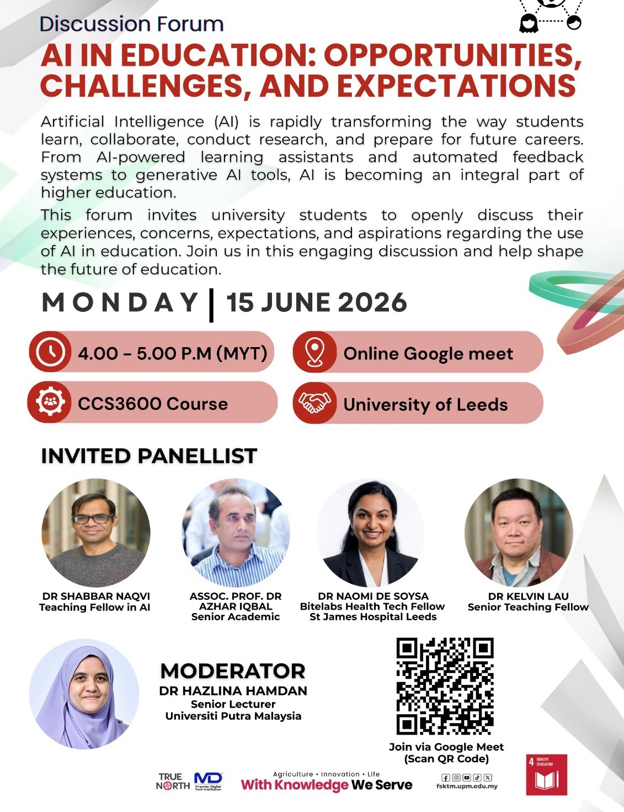
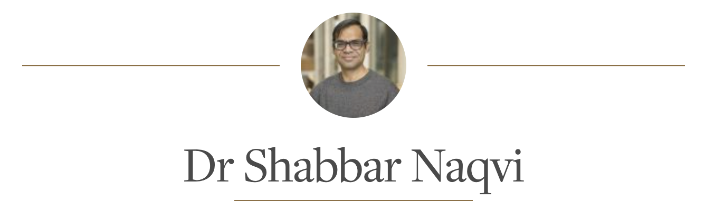
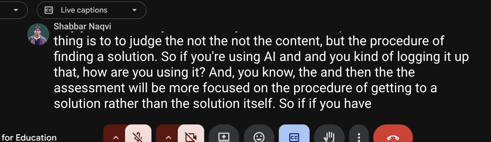
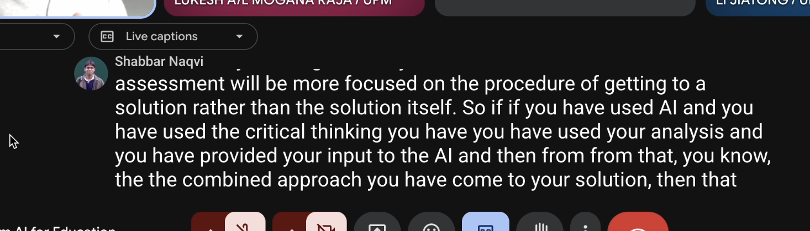
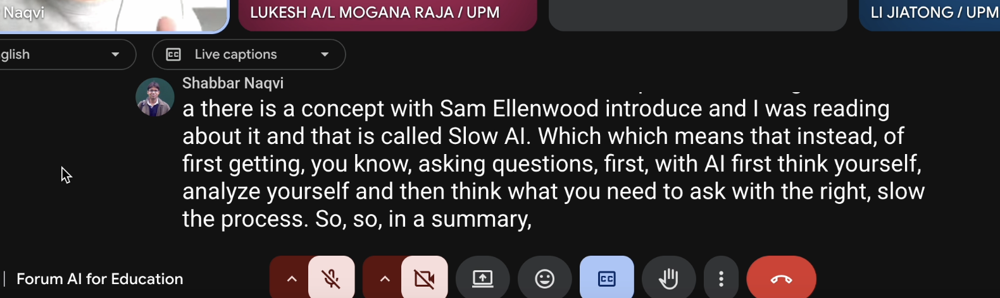
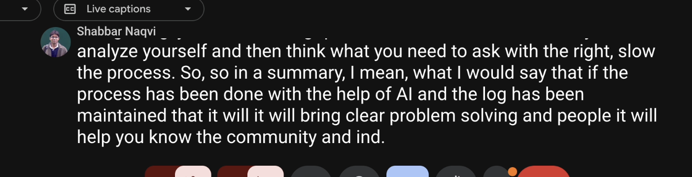
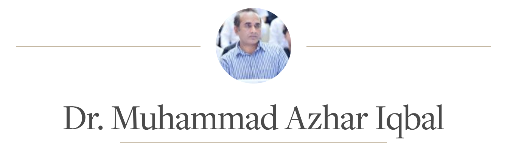
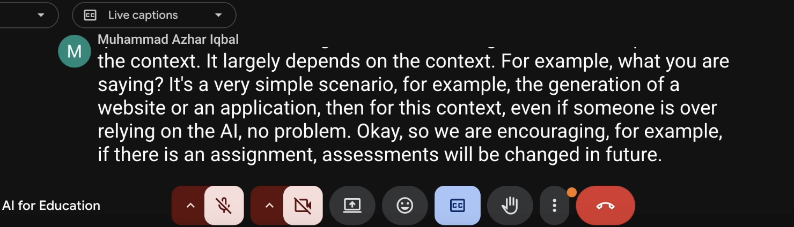
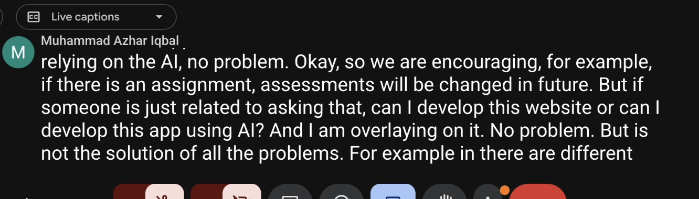

> **Research Question**
>
> What Should Education Evaluate in the Age of AI?

> **Don't judge the answer. Judge the process.**

## 研究背景

2026 年 6 月 15 日，星期一。我有幸被我的人工智能课程教授 Dr. Hazlina 选中，在一场关于 **AI in Education** 的线上座谈会中，向来自英国利兹大学的教授们提出相关问题，并得到了两位教授的回复。



我提出的问题是：

> Recently, some universities have started experimenting with AI-first courses, where students are encouraged to use AI extensively to build products, websites, and complete projects instead of restricting AI usage.
>
> Do you think higher education should move toward an AI-native learning model, where students are assessed based on what they can create with AI, rather than what they can do without AI?
>
> If so, how should universities redesign teaching and assessment to ensure students still develop deep understanding instead of becoming overly dependent on AI?

中文翻译如下：

> 最近，一些大学开始尝试人工智能优先课程，鼓励学生广泛使用人工智能来构建产品、网站和完成项目，而不是限制人工智能的使用。
>
> 你是否认为高等教育应该转向人工智能原生学习模式？在这种模式下，学生的评估基于他们能够利用人工智能创造什么，而不是他们在没有人工智能的情况下能够做什么。
>
> 如果是这样，大学应该如何重新设计教学和评估体系，以确保学生仍然能够形成深入理解，而不是过度依赖人工智能？

两位教授的回答虽然来自不同的研究背景，却共同指向了一个更深层的问题：

> **人工智能时代，我们究竟应该评价什么？**

## 观察一：Dr. Shabbar 的观点

Dr. Shabbar 是利兹大学计算机科学学院人工智能方向的教学研究员。拥有诺丁汉大学计算机科学博士学位和高等教育学院院士（FHEA）资格，在巴基斯坦俾路支斯坦工程技术大学担任高级学术和领导职务，包括副教授、系主任、研究生院主任和理学院院长。人工智能在教育中的应用是他的专业领域之一。



首先，他提到：

> 人工智能已经成为一种必需工具。
>
> 我们无法假装它不存在。
>
> 真正重要的是：你如何使用人工智能？

同时，他举出利兹大学当时正在热烈讨论的 “Green Use of AI”。其大致含义是：学生可以自由使用人工智能，但是必须展示自己的思考过程。

也就是所谓的：

> **Don't judge the answer. Judge the process.**


我认为，这句话的重要性已经超越了教育本身。

过去，人类社会的评价体系建立在“结果稀缺”的基础上。因为获取正确答案相对困难，所以答案本身就具有价值。

但在生成式人工智能时代，答案正在迅速贬值。真正稀缺的能力开始变成：

- 提出问题的能力；
- 构建推理过程的能力；
- 判断答案质量的能力；
- 在多个答案之间作出选择的能力。

如果说工业时代培养的是“执行者”，那么人工智能时代或许更需要“判断者”。

## 人类分析与人工智能辅助

其次，Dr. Shabbar 指出，人工智能可以参与问题求解，但使用者仍然需要：

- 使用自己的分析；
- 使用自己的批判性思维；
- 向人工智能输入自己的观点；
- 判断并验证人工智能给出的结果。

他所描述的过程可以概括为：

```text
Human Analysis
+
AI Assistance
↓
Solution
```

这可能是利用人工智能解决问题的更合理方式。






在这一模式下，评价的重点不应只落在最终方案上，还应包括使用者如何定义问题、如何形成初步判断、如何向人工智能输入自己的分析，以及如何检验人工智能生成的结果。

## Slow AI

最后，Dr. Shabbar 还提到了一个有意思的概念：“Slow AI”。

它的意思是：不要一上来就询问人工智能，而应该先完成必要的独立思考。

更合理的过程是：

1. 自己思考；
2. 自己分析；
3. 明确问题；
4. 再询问人工智能；
5. 再验证人工智能。

而不是：

```text
Question
↓
ChatGPT
↓
Copy
↓
Submit
```






这里的“慢”并不是拒绝效率，而是在使用人工智能之前保留必要的认知过程。

人工智能可以加快答案的产生，却不应替代问题形成、证据判断和责任承担。

## 观察二：Dr. Azhar Iqbal 的观点

Dr. Azhar Iqbal 于 2012 年在中国华中科技大学获得通信与信息系统博士学位。之后，他曾在多所大学担任不同职务。在加入利兹大学之前，阿扎尔博士曾在英国兰卡斯特大学担任教学研究员，在中国西南交通大学担任副教授，并在巴基斯坦首都科技大学担任副教授。他是 IEEE 高级会员和高等教育学院院士。

他是中国科技大学并行计算与网络（PCN）研究小组的创始成员之一，并构思了 PCN 关于云端大规模仿真分区与分布的关键项目。阿扎尔博士目前的研究处于农业数字化领域的前沿。他致力于开发基于人工智能的解决方案，旨在改进可持续的作物与畜牧生产系统。



他指出：

> **Context matters.**
>
> **It largely depends on the context.**

这很大程度上取决于具体场景。不同场景应该具有不同的标准。

例如：

> 如果学生利用人工智能开发网站或者开发应用程序，这没有问题。

甚至：

> 即使非常依赖人工智能，也没有太大问题。






我十分赞同这一判断，因为：

> **实践不等于考试。**

在实践场景中，只要结果以正当的方式达成，依赖人工智能的过程可以被评价，但不应该脱离具体场景而被简单评判。

最后，Dr. Azhar 输出了他的核心观点：

> **It is not applicable to all things.**

也就是说：

> **不存在一个适用于所有场景的人工智能规则。**

他以自己教授的智能系统课程为例：

```text
Intelligent Systems
智能系统
```

在一些课程中，如果学生采用以下方式：

```text
直接询问人工智能
↓
复制答案
```

这种做法根本不符合课程要求。

因为：

> **Teacher feedback is still necessary.**

最终仍然需要教师进行判断和反馈。


这一点其实非常深刻。

现在，围绕人工智能的讨论经常陷入两个极端：

- 支持人工智能的人认为所有事情都应该使用人工智能；
- 反对人工智能的人认为所有事情都不应该使用人工智能。

而 Dr. Azhar 告诉我们：

> **It really depends.**

真正重要的不是抽象地支持或反对人工智能，而是判断在什么场景、为了什么目标、以什么方式使用人工智能。

## 观察三：我的个人观点

Dr. Shabbar 和 Dr. Azhar 都认为：

> **Assessment will change in the future.**

在教育领域，从结果第一向重视过程的转变，可能正是人工智能时代教育评价体系的一项重大变化。

随着人工智能领域不断发展和突破，不只是教育领域，未来人类社会的许多方面都将被人工智能重塑。

人工智能素养应该成为所有“未来人”的必修能力，而不仅仅属于计算机专业学生。在很多事情上，使用人工智能，而不是仅仅依靠个人，也许才是更好的选择。

我们无法避开这一趋势。但是，在人工智能更加深入地进入教育、工作和公共生活之前，改变并完善相应的评价体系，我认为应该成为最优先的任务之一。

未来的教育评价不应仅仅围绕“是否使用人工智能”建立统一的禁令或许可，而应该至少回答以下问题：

1. 这项任务原本希望检验什么能力？
2. 人工智能参与后，哪些能力仍然由学生本人展示？
3. 学生是否能够解释、验证并对最终结果负责？

教育评价的对象也应该逐渐从单一的最终答案，扩展到问题定义、推理过程、证据使用、批判性判断、人机协作和责任承担。

## 尚未结束的问题

这次论坛没有给出最终答案。实际上，它让我产生了更多新的问题：

1. 人工智能时代应该如何定义“思考”？
2. 谁来制定人工智能的使用规则？
3. 不同学科、不同场景是否应该拥有不同的人工智能治理框架？
4. 教育制度究竟应该适应人工智能，还是主动塑造人工智能？

也许这些问题本身，比一个过早确定的答案更加重要。

而这或许正是 “Slow AI” 想提醒我们的事情：

> **不要急于获得答案。**
>
> **先学会提出更好的问题。**

## 参考资料

- AI in Education Forum, 15 June 2026.
- Dr. Shabbar Naqvi, University of Leeds.
- Dr. Muhammad Azhar Iqbal, University of Leeds.

---

*说明：本文根据论坛发言、实时字幕和个人现场笔记整理。部分英文引语经过必要的标点整理。如实时字幕存在转录偏差，应以发言者的原意为准。本文记录的是我在这一时间点形成的理解，而不是对相关问题的最终结论。类似文本也已同步到我的个人公众号：‘未竟札记’中。*
