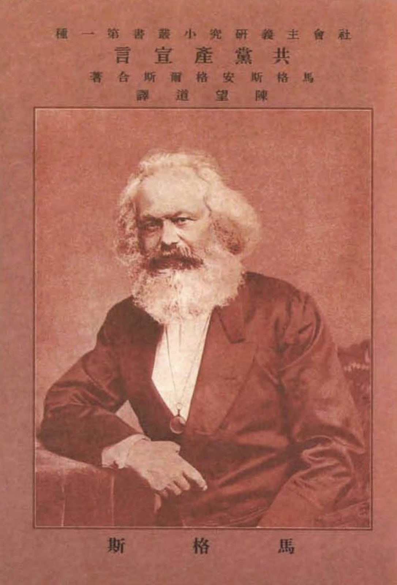
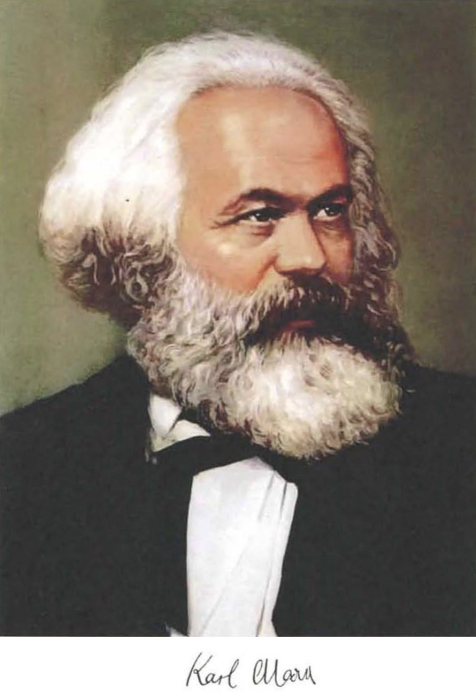
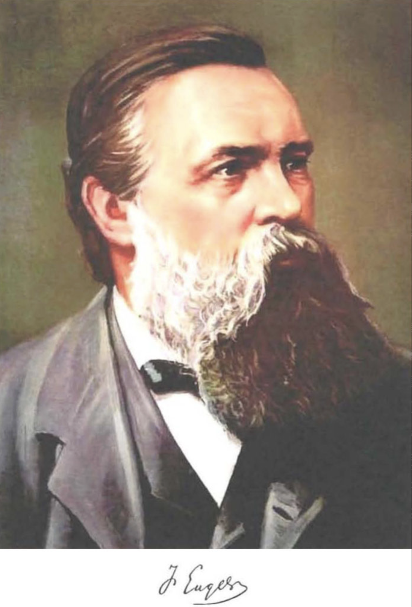
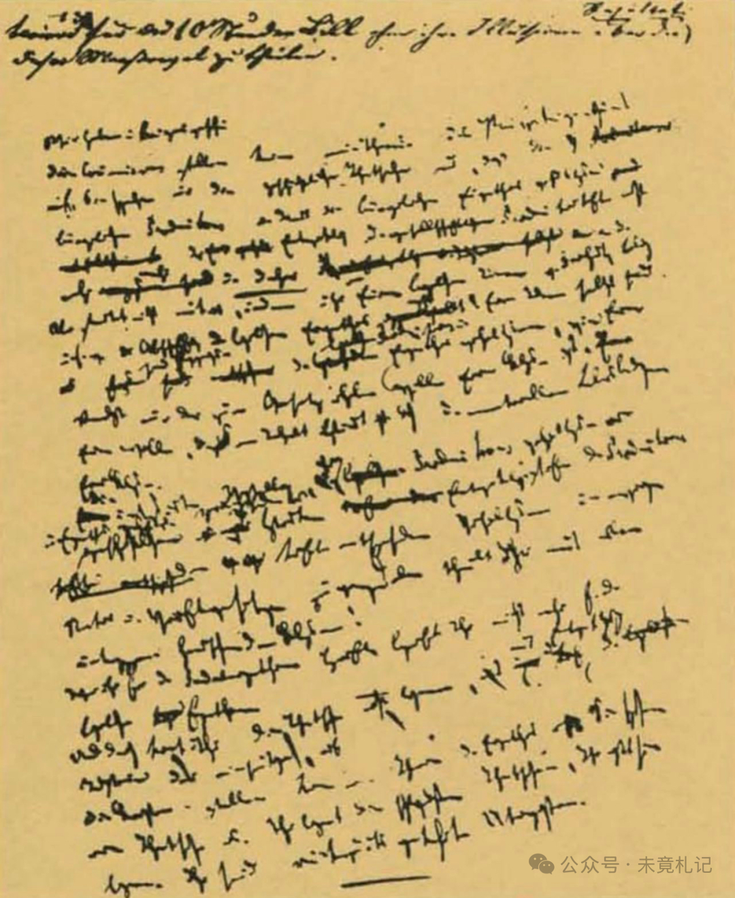
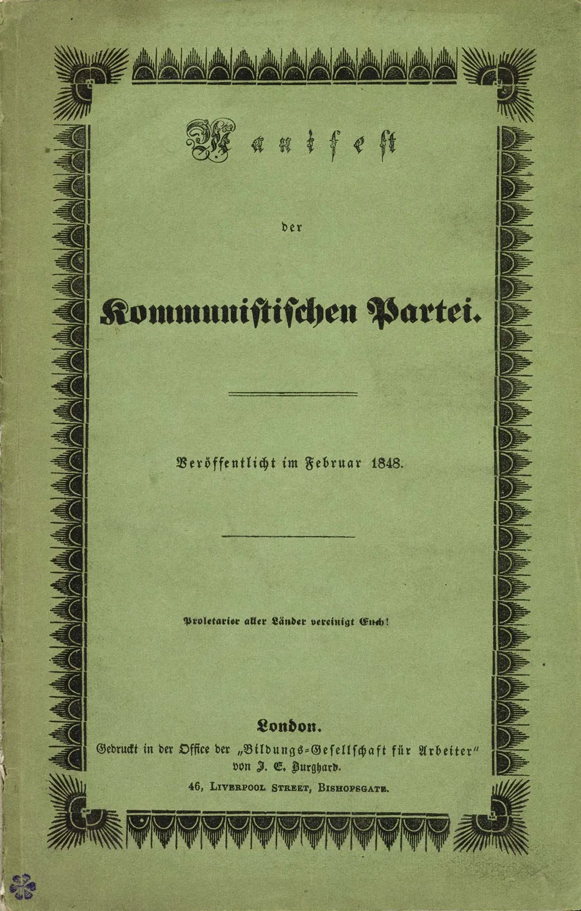
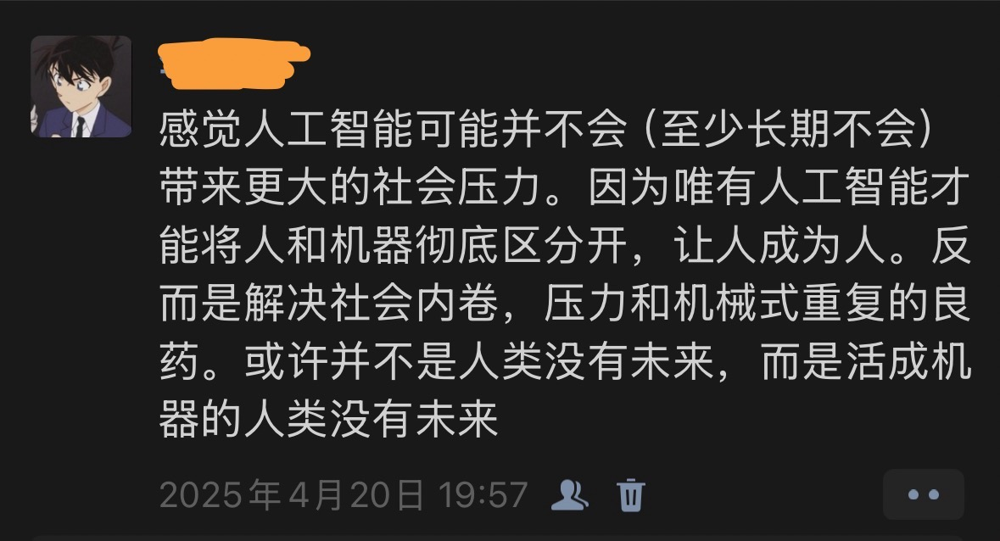

# Rereading *The Communist Manifesto*: Class, Capital, and Human Development

A sentence made me reopen *The Communist Manifesto*:

> “The history of all hitherto existing society is the history of class struggles.”

I had read this sentence before, but this time it struck me differently.

In the past, I tended to understand it as a grand historical claim. But when I reread it now, I began to see it less as a slogan and more as a method: a way of asking who controls production, who depends on whom, and whose life is shaped by structures they did not choose.

## Why Read *The Communist Manifesto* Today?

Two years ago, I once proposed a view:

> Gender opposition is not the fundamental contradiction.  
> Ethnic opposition is not the fundamental contradiction.  
> Class opposition is the long-standing social contradiction.

At that time, this was more of an intuition. After rereading *The Communist Manifesto*, I began to think about this view more carefully.

The question is not simply whether Marx was “right” or “wrong” in a narrow sense. The more important question is: what did Marx actually see?

## What Did Marx See?

Marx saw that the opposition between the bourgeoisie and the proletariat was, at its core, an opposition between a minority and the majority.

In Marx’s time, the opposition between the property-owning class and the propertyless class was relatively direct. The structure of domination was more visible. But in modern society, this opposition has become more complicated.

The expansion of the property-owning class, the emergence of new social identities such as the “middle class,” and the stabilizing effects of modern institutions have made class relations appear less direct. But this does not mean that class contradictions have disappeared. In many cases, they have only become more mediated, more concealed, and more difficult to recognize.

Marx saw very early that:

> “The history of all hitherto existing society is the history of class struggles.”

## Why Does Capitalism Never Stop Changing?

Capitalism has brought real historical changes. I do not deny its positive effects.

With the development of the bourgeoisie, the expansion of free trade, the creation of world markets, the rise of industrial production, and the gradual convergence of living conditions across countries, many old forms of separation and opposition have been weakened.

However, the negative side is equally important.

Wars, economic crises, especially cyclical commercial crises, and continuous social instability are not accidental phenomena outside capitalism. They are closely connected to capitalism’s own tendency to expand, revolutionize production, and reshape society.

The original text says:

> “The bourgeoisie cannot exist without constantly revolutionising the instruments of production, and thereby the relations of production, and with them the whole relations of society.  
> Constant revolutionising of production, uninterrupted disturbance of all social conditions, everlasting uncertainty and agitation distinguish the bourgeois epoch from all earlier ones.”

Capitalism must constantly expand, constantly innovate, and constantly reorganize society in order to survive.

In my view, wars, crises, and continuous social transformation are all closely related to this logic of endless expansion.

## Capital Changes Not Only Wealth, But Human Relations

Marx’s critique of capital is not simply about redistribution of wealth. It is also about whether capital changes the relationship between human beings.

One of the most striking passages in *The Communist Manifesto* is:

> “The bourgeoisie has stripped of its halo every occupation hitherto honoured and looked up to with reverent awe.  
> It has converted the physician, the lawyer, the priest, the poet, the man of science, into its paid wage labourers.”

Capital does not merely create wealth. It also reorganizes human relationships.

It tears away the emotional veil from family relations and reduces many relationships into money relations. It turns professions, knowledge, skills, and even moral authority into commodities.

This point made me reconsider a widespread assumption in modern society: that the propertyless class, such as peasants, workers, and manual labourers, naturally deserve lower wages, lower status, and lower living standards than capital owners and so-called “elites.”

This assumption is cruel, but it still exists widely.

I began to understand why Marx emphasized human liberation rather than merely wealth redistribution. *The Communist Manifesto* is not only asking who owns wealth. It is also asking whether human value can exist beyond capital logic.

## Why Are Wages Always Only Wages?

Wages are the cost of reproducing labour power.

In general, wages only need to maintain the worker’s life and allow the reproduction of the next generation of workers.

The text says:

> “The modern labourer, on the contrary, instead of rising with the progress of industry, sinks deeper and deeper below the conditions of existence of his own class.  
> He becomes a pauper, and pauperism develops more rapidly than population and wealth.”

In simple terms, labourers can survive only when they find work, and they can find work only when their labour increases capital.

This means that workers, like commodities, are exposed to competition, market fluctuations, and the instability of capitalist production.

Capital’s exploitation of workers is not one-dimensional. It appears in multiple forms.

When the factory owner’s exploitation ends, and the worker receives wages in cash, another part of the bourgeoisie immediately appears: the landlord, the shopkeeper, the pawnbroker, and others.

The worker is not freed by receiving wages. In many cases, wages simply become the starting point of another chain of dependence.

## Why Did Communism Propose the Abolition of Private Property?

The first time people encounter *The Communist Manifesto*, one of the easiest sentences to misunderstand is:

> “The theory of the Communists may be summed up in the single sentence: abolition of private property.”

But *The Communist Manifesto* is not saying that all personal belongings should be taken away.

It clearly states that capital is not merely a personal force. Capital is a social force.

Therefore, to transform capital into common property does not mean turning personal belongings into collective property. What changes is the social character of property: capital loses its class character.

The question is therefore not:

> Should individuals be allowed to possess personal life materials?

The real question is:

> Should capital be allowed to dominate labour?

This distinction is crucial.

What is to be abolished is not personal life materials, but the system in which capital dominates labour.

## Education: Does AI Make Humans More Like Machines, or More Fully Human?

Education has obvious class characteristics. Today’s education system has slowly become one of the tools through which class position is reproduced, even though we often accept it as natural.

Marx wrote:

> “The bourgeoisie sees in education the production of instruments of production.  
> For the enormous majority, education is merely training them to act as machines.”

When I reread this passage, I began to think about contemporary AI education.

Will AI education become the kind of education Marx criticized, one that trains people into machines? Or could AI, paradoxically, make it more possible for humans to become fully human?

This reminded me of an earlier forum on AI in education.

Dr. Shabbar emphasized:

> Don’t judge the answer. Judge the process.  
> Slow AI.

Dr. Azhar emphasized:

> Context matters.

Both of them recognized that AI will affect education, and that assessment systems will have to change.

For a long time, I worried that artificial intelligence would make humans increasingly machine-like. Later, I began to develop almost the opposite view:

> Perhaps artificial intelligence will not increase social pressure in the long run.  
> Perhaps only artificial intelligence can truly separate humans from machines and allow humans to become more human.  
> The real danger may not be a future without humans, but a future where humans are forced to live like machines.

This led me to reinterpret Marx’s argument:

> Education should not train human beings into machines.

## The Necessity of Socialism with Chinese Characteristics

Marx and Engels also wrote in the preface that the practical application of the principles in *The Communist Manifesto* must always depend on the historical conditions of the time.

This sentence is important.

It means that socialism cannot be understood as an abstract formula detached from reality. Any social system must be judged in relation to the productive forces, historical conditions, institutional capacities, and social contradictions of its own time.

This helped me better understand why communism could not be realized prematurely.

Marx wrote:

> “All previous historical movements were movements of minorities, or in the interest of minorities.  
> The proletarian movement is the self-conscious, independent movement of the immense majority, in the interest of the immense majority.”

The question of socialism is therefore not merely the question of redistribution. It is also the question of whether society can be organized in a way that serves the majority rather than a minority.

This is why the relationship between the minority and the majority becomes central.

A system cannot be evaluated only by how much wealth it produces. It must also be evaluated by how that wealth is socially organized, who benefits from development, and whether human development is made possible for the majority.

Rereading *The Communist Manifesto* was not, for me, an attempt to find a ready-made answer that can be copied into the present.

Rather, it became a way of asking new questions about reality.

When I closed the book again, I was no longer trying to prove whether every conclusion in it still applies today.

What I took away was a method of inquiry: to keep questioning reality, to understand history, and to reflect on institutions.

Perhaps the true value of a classic is not that it answers questions for us once and for all, but that it continues to teach us how to ask better questions.

> “In place of the old bourgeois society, with its classes and class antagonisms,  
> we shall have an association, in which the free development of each is the condition for the free development of all.”

## Questions Generated by This Essay

This essay does not end with a conclusion. It generates several questions that I want to continue investigating.

### 1. Can Human Value Transcend Capital Logic?

This is the central question of the essay.

*The Communist Manifesto*, artificial intelligence, education, and labour all point toward this question.

If capital tends to measure human beings through productivity, wages, exchange value, and market usefulness, then the key question becomes whether human value can be understood beyond capital logic.

### 2. How Can the Interests of the Minority and the Majority Be Reconciled?

This question extends class analysis into broader issues of governance.

It is connected to:

- state governance;
- public policy;
- democracy;
- wealth distribution;
- institutional design.

The question is not only whether the majority should benefit, but also how a political and economic system can manage the relationship between minority interests and majority welfare.

### 3. What Constitutes the Success of Capitalism? What Constitutes the Success of Socialism?

This question asks how we should evaluate a social system.

Is capitalism successful because it generates wealth, innovation, and productivity?

Is socialism successful because it reduces domination, expands equality, and enables human development?

This question also connects with my earlier question in AI education:

> What should education evaluate?

In both cases, the deeper issue is the same:

> What criteria should we use when evaluating institutions?

### 4. Can Artificial Intelligence Make Humans More Human?

This is one of the most important questions generated by the intersection between *The Communist Manifesto* and AI education.

If industrial capitalism trained many people to act like machines, then artificial intelligence raises a new possibility:

Could AI reduce mechanical repetition and allow humans to focus more on judgment, creativity, care, responsibility, and meaning?

Or will AI deepen the existing logic of control, competition, and alienation?

### 5. How Is Artificial Intelligence Transforming the Relations of Production?

This is the most direct connection between *The Communist Manifesto* and artificial intelligence.

AI is not only a tool. It may also reshape labour, ownership, management, productivity, and the relationship between humans and production systems.

This question may become a natural bridge toward future research on *Capital*, platform economies, agentic AI, automation, and digital capitalism.

## References

- Marx, Karl, and Friedrich Engels. *The Communist Manifesto*.
- Marx, Karl. *Capital*, Volume I.
- Notes from previous research reflections on AI education and assessment.